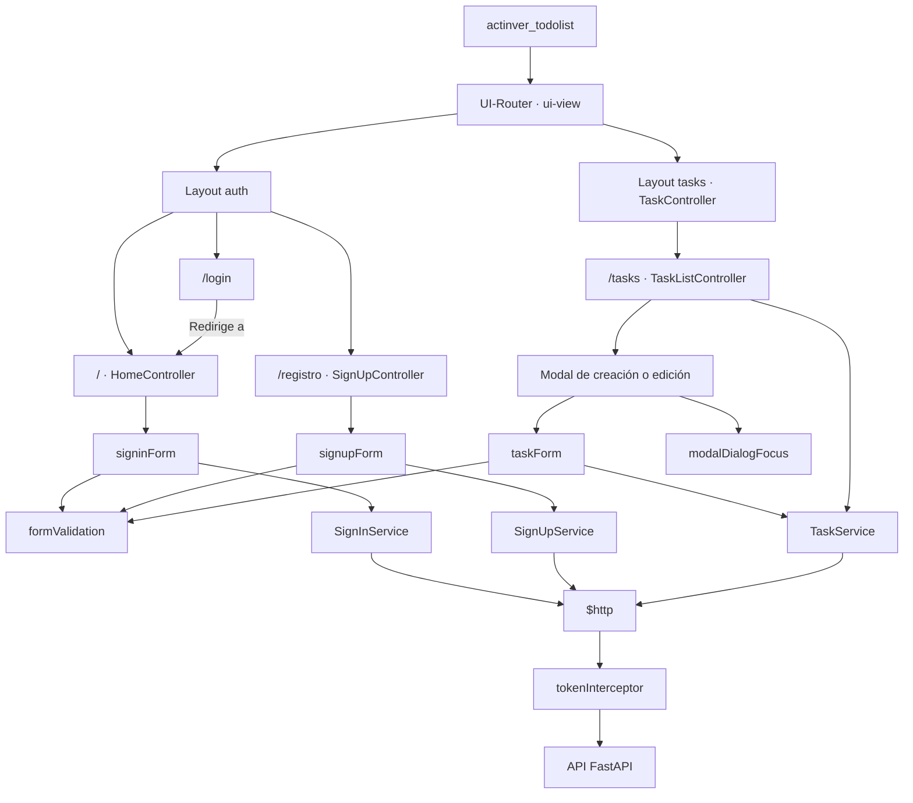

# Actinver ToDo List

## Requisitos de desarrollo

- Node.js 24 (desde la versión 24.15.0) y npm.
- AngularJS 1.8.3, Bootstrap 3.4.1 y Gulp 5, declarados en `package.json`.
- Python 3.11 o posterior para el backend.
- FastAPI, Uvicorn y las demás dependencias de `backend/requirements.txt`.

## Instalación

### Frontend

Desde la raíz del proyecto, instala las dependencias con las versiones de `package-lock.json`.

```sh
npm ci
```

### Backend

En el primer arranque, `./backend/start.sh` crea el entorno virtual en `backend/.venv` e instala las dependencias de `backend/requirements.txt`.

## Ejecución en desarrollo

Desde la raíz del proyecto, ejecuta cada servicio en una terminal distinta.

### Backend

```sh
./backend/start.sh
```

La API queda disponible en [http://localhost:1337](http://localhost:1337).

### Frontend

Con las dependencias de npm disponibles, inicia el servidor de desarrollo.

```sh
npm start
```

Abre la aplicación en [http://localhost:3000](http://localhost:3000).

## Configuración local

El frontend toma las direcciones de `local.env` en [`configFile.json`](configFile.json).

- `env.api` es la URL base de las peticiones de tareas y registro. El valor local es `http://localhost:1337/api`.
- `env.tokenUrl` es la URL completa de inicio de sesión. El valor local es `http://localhost:1337/Token`.

Si cambias el puerto del backend, actualiza ambas URLs. El servidor de desarrollo recompila al detectar cambios en el archivo. Recarga la página para aplicar los nuevos valores.

## API y sesión

- Al iniciar sesión, el frontend guarda `access_token` en `localStorage`.
- La vista `/tasks` requiere un token guardado. Si falta, el guard redirige al inicio. Si hay un token guardado, el guard de las vistas de acceso redirige a `/tasks`.
- El interceptor agrega `Authorization: Bearer <token>` a las peticiones de tareas. Si la API devuelve `401` para una petición que llevaba el token actual, el interceptor lo elimina y redirige al inicio.
- Cerrar sesión elimina el token del navegador y vuelve al inicio.

El contrato de endpoints está en la [documentación del backend](backend/README.md#contrato-compatible-con-angular). Con el backend en ejecución, puedes consultar la [documentación interactiva de FastAPI](http://localhost:1337/docs).

## Composición de AngularJS



- `formValidation` controla el envío de los tres formularios. `modalDialogFocus` maneja el foco y el cierre con Escape.
- Los guards de UI-Router consultan el token guardado para decidir si muestran las vistas de acceso o de tareas. El interceptor adjunta el token a las peticiones protegidas y la API valida su vigencia.

> [!WARNING]
> Este proyecto contiene dependencias que no deben usarse en producción. Úsalo únicamente para desarrollo y evaluación.
